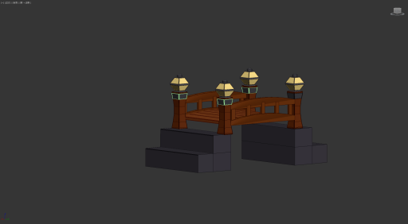
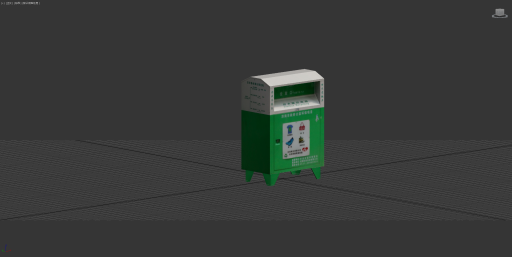
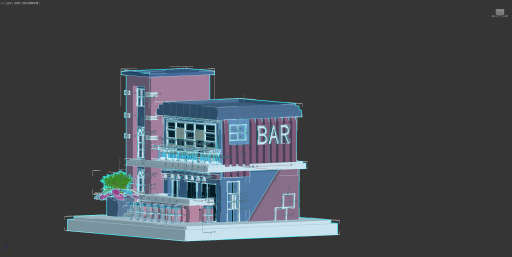
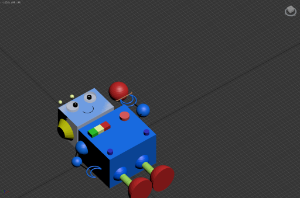

# 3D ��ģ��Ʒ��

�ҵ� 3ds Max ��ģ��ϰ��������������������������䡢���ݡ�������ģ�ͻ����˵���Ʒ��

���ֿ���¼ **6 �� `.max` ģ��Դ�ļ�**�� **8 �� JPG ��ͼ**��ԭʼ�ļ��ϼ�Լ **16.1 MiB**������ԭ���ļ�������ͼĿ¼��

## ��ƷԤ��

����ͼƬ��ȡ��ģ���ļ��Դ�������ͼ��չʾ����ʱ����ͼ����������������Դ�ļ����� 3ds Max �в鿴��

| ˫���� | ���� |
| :---: | :---: |
|  |  |
| ��������� | ���� |
|  |  |
| ������ģ | ������ |
|  |  |

## Դ�ļ�Ŀ¼

| ��Ʒ | ģ��Դ�ļ� | �ļ���С |
| --- | --- | ---: |
| ˫���� | [2buildings.max](2buildings.max) | 3.78 MiB |
| ���� | [bridge.max](bridge.max) | 1.36 MiB |
| ��������� | [clothingRecyclingBin.max](clothingRecyclingBin.max) | 0.61 MiB |
| ���� | [house.max](house.max) | 8.12 MiB |
| ������ģ | [line.max](line.max) | 0.82 MiB |
| ������ | [robot.max](robot.max) | 0.93 MiB |

���������������ͼλ�� [`���������ͼ/`](%E8%A1%A3%E7%89%A9%E5%9B%9E%E6%94%B6%E8%B4%B4%E5%9B%BE/)������ `ZYJ_01.jpg` �� `ZYJ_08.jpg`��

## �������

1. �ڲֿ�ҳ��ѡ�� **Code �� Download ZIP**�����غ�������ѹ��
2. ʹ�� Autodesk 3ds Max ����Ҫ�鿴�� `.max` �ļ���
3. ��������������ʾȱ����ͼ������ѹ��� `���������ͼ` �ļ������ӵ���ͼ����·����������Դ׷�ٴ���������ָ�����ļ��С�
4. ���������汾�Ͳ��������δ������֤�����Դ��ļ�ʱ��������ʾΪ׼��

## �ļ�˵��

- `.max`��ԭʼ�ɱ༭ģ���ļ���
- `���������ͼ/`��ԭʼ JPG ��ͼ��
- `previews/`����ģ����Ƕ����ͼ��ȡ�� PNG Ԥ����
- `SHA256SUMS.txt`��14 ��ԭʼ�ļ��� SHA-256 У��ֵ�������ں˶����غ�������ԡ�

��������������ȫ��ԭʼģ������ͼ���ݣ�δ�Գ������½�ģ����Ⱦ��
