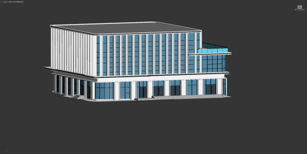
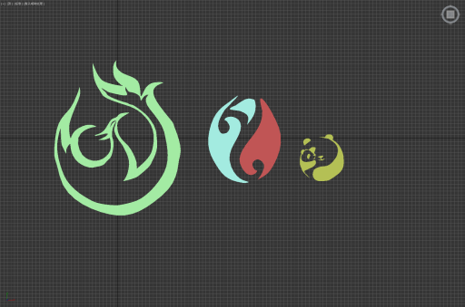

# 3D 建模作品集

我的 3ds Max 建模练习，包含建筑、桥梁、衣物回收箱、房屋、线条建模和机器人等作品。

本仓库收录 **6 个 `.max` 模型源文件**与 **8 张 JPG 贴图**。原始文件合计约 **16.1 MiB**，保留原有文件名及贴图目录。

## 作品预览

以下图片提取自模型文件自带的缩略图，展示保存时的视图。完整场景请下载源文件后在 3ds Max 中查看。

| 双建筑 | 桥梁 |
| :---: | :---: |
|  |  |
| 衣物回收箱 | 房屋 |
|  |  |
| 线条建模 | 机器人 |
|  |  |

## 源文件目录

| 作品 | 模型源文件 | 文件大小 |
| --- | --- | ---: |
| 双建筑 | [2buildings.max](2buildings.max) | 3.78 MiB |
| 桥梁 | [bridge.max](bridge.max) | 1.36 MiB |
| 衣物回收箱 | [clothingRecyclingBin.max](clothingRecyclingBin.max) | 0.61 MiB |
| 房屋 | [house.max](house.max) | 8.12 MiB |
| 线条建模 | [line.max](line.max) | 0.82 MiB |
| 机器人 | [robot.max](robot.max) | 0.93 MiB |

衣物回收箱配套贴图位于 [`衣物回收贴图/`](%E8%A1%A3%E7%89%A9%E5%9B%9E%E6%94%B6%E8%B4%B4%E5%9B%BE/)，包含 `ZYJ_01.jpg` 至 `ZYJ_08.jpg`。

## 下载与打开

1. 在仓库页面选择 **Code → Download ZIP**，下载后完整解压。
2. 使用 Autodesk 3ds Max 打开需要查看的 `.max` 文件。
3. 如果衣物回收箱提示缺少贴图，将解压后的 `衣物回收贴图` 文件夹添加到贴图搜索路径，或在资源追踪窗口中重新指定该文件夹。
4. 具体软件版本和插件依赖尚未逐项验证，请以打开文件时的软件提示为准。

## 文件说明

- `.max`：原始可编辑模型文件。
- `衣物回收贴图/`：原始 JPG 贴图。
- `previews/`：从模型内嵌缩略图提取的 PNG 预览。
- `SHA256SUMS.txt`：14 个原始文件的 SHA-256 校验值，可用于核对下载后的完整性。

本次整理保留了全部原始模型与贴图内容，未对场景重新建模或渲染。
